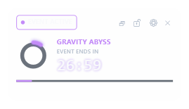
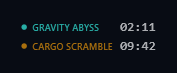
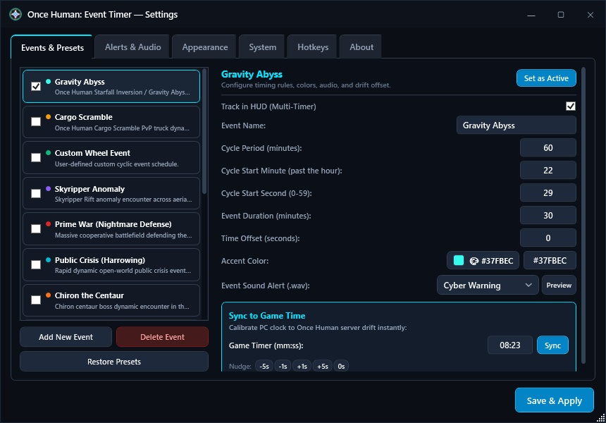
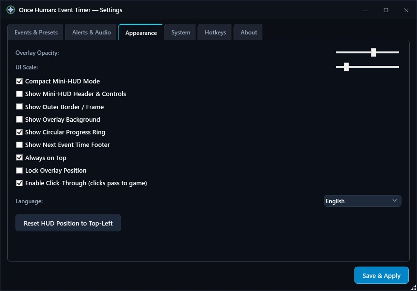
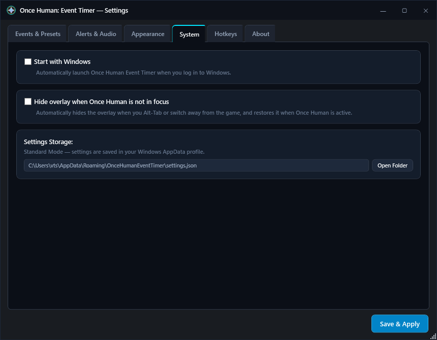
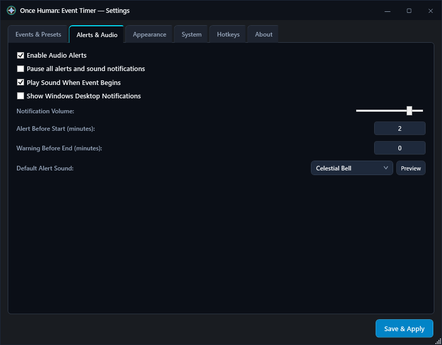

# Once Human: Event Timer

A modern, high-performance desktop HUD overlay for **Once Human** that tracks recurring in-game events in real time. Designed with a dark cyberpunk aesthetic, sub-second server clock synchronization, customizable sound alerts, and zero-impact click-through gameplay support.

---

## Screenshots

  
   
  <em>In-game desktop HUD overlay tracking multiple concurrent events with neon progress rings, phase badges, and active countdown bars.</em>

  
   
  <em>Ultra-compact floating Mini-HUD mode showing next active event and remaining time.</em>

  
   
  <em>Universal event scheduling engine with 14 built-in Once Human presets, custom dark scrollbar, and zero-drift server sync.</em>

  
   
  <em>Granular appearance settings for transparency, scale, borders, circular progress rings, and Mini-HUD header controls.</em>

  
   
  <em>System settings with Windows Autostart integration and automatic game foreground window detection.</em>

  
   
  <em>Procedural synthesizer audio presets, volume controls, and per-event sound assignment.</em>

---

## Features

- **Real-Time Event Tracking & Auto-Sorting**:
  - Track single or multiple concurrent event timers simultaneously on a clean desktop HUD.
  - Dynamic event auto-sorting prioritizes active events first, followed by events closest to starting.
  - Switch between Full HUD (circular progress rings, countdown bars) and Mini-HUD (minimal floating badge).

- **Second-Precision Zero-Drift Synchronization**:
  - Sub-second server cycle anchor: Gravity Abyss triggers at exact server second `XX:22:29` with `0s` offset, providing zero-drift accuracy out of the box.
  - Dynamic game clock synchronization: enter in-game remaining time (e.g. `08:23`) to calibrate clock skew immediately.
  - Quick-calibration nudge buttons (`-5s`, `-1s`, `+1s`, `+5s`, `0s`) for instant adjustment.

- **Game Focus Detection (Smart Auto-Hide)**:
  - Automatically conceals the overlay when *Once Human* is not the active window (e.g., when Alt-Tabbing to a web browser or another desktop app).
  - Instantly restores the overlay when returning to the game.

- **Click-Through Mode & Overlay Customization**:
  - Full click-through support (`WS_EX_TRANSPARENT`): mouse clicks pass directly into the game without interrupting aiming or combat.
  - Position lock to prevent accidental dragging during intense encounters.
  - Granular visual controls: toggle outer border glow, card background transparency, progress ring, next event footer, and Mini-HUD header controls.

- **Full-Spectrum Native Color Picker**:
  - Native Windows color palette dialog (`ChooseColor`) integration.
  - Assign any custom RGB/HEX accent color to individual events with live preview swatches.

- **Procedural Synthesizer & Per-Event Audio**:
  - Built-in audio library featuring 7 procedural synthesized alert presets (`Celestial Bell`, `Cosmic Pulse`, `Stardust Ping`, `Quantum Chord`, `Deep Resonance`, `Cyber Warning`, `Emergency Siren`).
  - Support for custom user `.wav` audio files per individual event or as global defaults.
  - Built-in instant preview audio test buttons.
  - Dedicated hotkey and quick toggle to pause/mute alerts and notifications on demand.

- **System Integration & Automatic Updates**:
  - Optional Windows Autostart (`HKCU\Software\Microsoft\Windows\CurrentVersion\Run`) configured via the dedicated System settings tab.
  - Built-in GitHub update checker with changelog viewer and seamless in-place executable replacement.

- **Multilingual Support**:
  - Full native localization in English (`en-US`), German (`de-DE`), and Russian (`ru-RU`).

---

## Distribution Formats

Releases are available in three distinct packages on the [GitHub Releases](https://github.com/vtstv/OHTimer/releases) page:

| Package | Filename | Size | Requirements |
| :--- | :--- | :---: | :--- |
| **Portable (Lightweight)** | `OnceHumanTimer-v1.5.3-portable.zip` | ~0.38 MB | Requires [.NET 8 Desktop Runtime](https://dotnet.microsoft.com/download/dotnet/8.0). Ultra-compact single file. |
| **Standalone (Plug & Play)** | `OnceHumanTimer-v1.5.3-standalone.zip` | ~63 MB | Zero dependencies. Fully self-contained single executable. |
| **Windows Setup Installer** | `OnceHumanTimer-v1.5.3-Setup.exe` | ~64 MB | Inno Setup wizard with Start Menu / Desktop shortcuts and Windows uninstaller. |

---

## Keyboard Shortcuts

| Shortcut | Action |
| :--- | :--- |
| <kbd>Ctrl</kbd> + <kbd>Alt</kbd> + <kbd>S</kbd> | Toggle HUD overlay visibility |
| <kbd>Ctrl</kbd> + <kbd>Alt</kbd> + <kbd>L</kbd> | Toggle click-through mode and position lock |
| <kbd>Ctrl</kbd> + <kbd>Alt</kbd> + <kbd>P</kbd> | Toggle pause / resume for audio alerts and notifications |

---

## Installation & Usage

1. **Download**: Obtain your preferred release format from [GitHub Releases](https://github.com/vtstv/OHTimer/releases).
2. **Run**:
   - For portable editions, extract the ZIP file and run `OnceHumanEventTimer.exe`.
   - For the installer, run `OnceHumanTimer-v1.5.3-Setup.exe` and follow the setup wizard.
3. **Positioning**: Drag the HUD overlay to your preferred screen location. Use the lock button on the overlay or context menu to lock the position.
4. **Configuration**: Click the gear icon or right-click the system tray icon to access Settings. Select which events to track, customize colors, configure sound alerts, or calibrate time.
5. **Game Synchronization**: Under **Events & Presets**, compare the in-game event timer with the HUD. Enter the minutes and seconds remaining in-game and click **Sync** to calibrate.

---

## System Requirements

- **Operating System**: Windows 10 (64-bit, version 19041+) or Windows 11
- **Runtime**: [.NET Desktop Runtime 8.0](https://dotnet.microsoft.com/download/dotnet/8.0/runtime) (only for the lightweight portable package; standalone and installer packages bundle the runtime)

---

## Author & License

Developed and maintained by **Murr** ([GitHub](https://github.com/vtstv)).

Released under the [MIT License](LICENSE).
