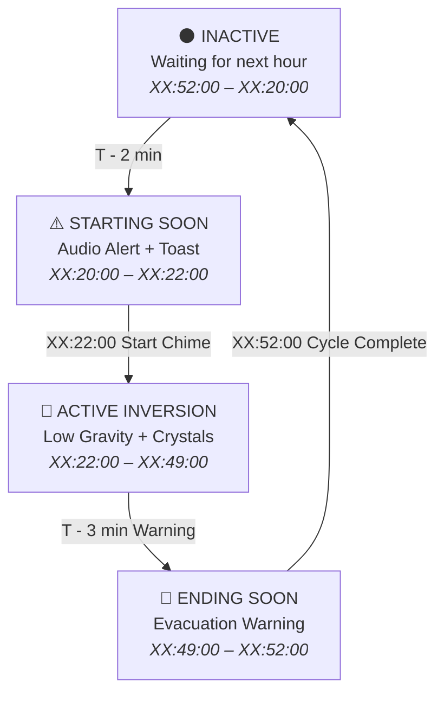

# Once Human: Starfall Inversion Timer 🌌⏱️

[](https://github.com/vtstv/StarfallTimer/actions)


[](LICENSE)


A sleek, lightweight, cyberpunk desktop HUD overlay for **Once Human**, tracking the hourly **Starfall Inversion** event in real-time. Designed with a transparent obsidian glass aesthetic, zero-latency Win32 click-through technology, procedural audio synthesis alerts, and multilingual localization.

---

## 📖 Table of Contents

- [The Starfall Inversion Event](#-the-starfall-inversion-event)
- [Key Features](#-key-features)
- [HUD Preview](#-hud-preview)
- [Event Phase Lifecycle](#-event-phase-lifecycle)
- [Default Hotkeys & Controls](#-default-hotkeys--controls)
- [Architecture Overview](#-architecture-overview)
- [Prerequisites & Building from Source](#-prerequisites--building-from-source)
- [Configuration Reference](#-configuration-reference)
- [Authors & Credits](#-authors--credits)
- [License](#-license)

---

## 🌠 The Starfall Inversion Event

In the post-apocalyptic world of *Once Human*, the **Starfall Inversion** is a recurring cosmic phenomenon that transforms gravitational physics across the wilderness:

- **Hourly Cycle**: Triggers every 60 minutes across all global and local servers.
- **Event Start**: 22 minutes past each hour (`XX:22:00`).
- **Event End**: 52 minutes past each hour (`XX:52:00`).
- **Active Duration**: 30 minutes of low-gravity anomaly.
- **Gameplay Significance**:
  - Low-gravity tide allows players to leap across chasms, scale high cliffs, and access secluded Stardust anomalies.
  - Floating **Starfall Crystals** and rare resources spawn across the zone, yielding essential materials for end-game crafting and deviant progression.
  - Missing the start window means losing out on high-yield harvest nodes until the next hour rollover.

**Starfall Timer** ensures you never miss a low-gravity window, providing precision countdowns, customizable audio cues, and seamless in-game situational awareness.

---

## ✨ Key Features

- **Frameless Cyberpunk HUD Overlay**:
  - Deep obsidian transparent card (`#0D1117`) with dynamic neon accent glow.
  - Circular countdown timer ring with synchronized linear progression bar.
  - Customizable scale (0.7x to 2.0x) and background opacity (20% to 100%).
  - Position lock prevents accidental mouse drag during heated combat.

- **Non-Intrusive Click-Through Mode**:
  - Utilizes native Windows API styles (`WS_EX_TRANSPARENT` & `WS_EX_LAYERED`).
  - When enabled, mouse clicks and cursor aim pass directly through the HUD into *Once Human* without focus interruption or stutter.

- **Procedural In-Memory Audio Synthesis**:
  - Built-in sound engine generating pure PCM WAV chimes dynamically in memory without external audio library dependencies.
  - Distinct harmonic chords for each phase:
    - **Starting Soon**: 2-tone alert chime (660 Hz → 880 Hz).
    - **Event Start**: 4-note major arpeggio celebration chime (C5 → E5 → G5 → C6).
    - **Ending Soon**: Descending caution tones (A5 → F5 → D5).
  - Optional support for custom external `.wav` sound files.

- **Desktop Notifications & System Tray**:
  - Native Windows taskbar notification tray icon with comprehensive context menu.
  - Configurable Windows toast/balloon notifications when an inversion approaches.
  - Quick action commands: Open HUD, Toggle Lock, Settings, and Clean Exit.

- **Multilingual Support**:
  - Instant on-the-fly language switching without application restart.
  - Fully translated in:
    - 🇺🇸 **English** (`en-US`)
    - 🇷🇺 **Russian** (`ru-RU`)
    - 🇨🇳 **Simplified Chinese** (`zh-CN`)

- **Configurable Global Hotkeys**:
  - Register system-wide key combinations using Win32 `RegisterHotKey` for instantaneous overlay toggling and click-through switching even while full-screen in-game.

- **Enterprise-Grade .NET 8 Architecture**:
  - Built on modern **C# 12** and **.NET 8 LTS**.
  - Strict MVVM architecture powered by `CommunityToolkit.Mvvm`.
  - Pure domain core (`StarfallTimer.Core`) completely decoupled from Windows/UI dependencies.
  - High-resolution 1-second tick loop with zero-allocation memory discipline.

---

## 🖥️ HUD Preview

```text
┌──────────────────────────────────────────────────────┐
│  ● ACTIVE                         [ 🔓 ]  [ ⚙ ]  [ ✕ ] │
├──────────────────────────────────────────────────────┤
│                                                      │
│     ╭─────╮     Low-Gravity Tide Active             │
│   ╭─╯     ╰─╮                                        │
│   │  18:42  │   24:18                                │
│   ╰─╮     ╭─╯   REMAINING COUNTDOWN                  │
│     ╰─────╯                                          │
│                                                      │
│  [==========================----------------------]  │
│                                      Next End: 17:52 │
└──────────────────────────────────────────────────────┘
```

### Visual State Palette

| Phase State | Neon Accent | Hex Code | Visual Meaning |
| :--- | :--- | :--- | :--- |
| **Inactive** | Neon Cyan | `#00F0FF` | Event is inactive; counting down to next inversion window. |
| **Starting Soon** | Amber Warning | `#F59E0B` | Event begins in ≤ 2 minutes (prepare gear and teleport). |
| **Active** | Cosmic Purple / Gold | `#A855F7` / `#EAB308` | Starfall Inversion active; low-gravity harvest underway! |
| **Ending Soon** | Red Alert | `#EF4444` | Inversion concludes in ≤ 3 minutes (evacuate cliffs). |

---

## 🔄 Event Phase Lifecycle



---

## ⌨️ Default Hotkeys & Controls

| Shortcut | Action | Description |
| :--- | :--- | :--- |
| <kbd>Ctrl</kbd> + <kbd>Alt</kbd> + <kbd>S</kbd> | **Toggle Overlay** | Shows or hides the HUD overlay window instantly. |
| <kbd>Ctrl</kbd> + <kbd>Alt</kbd> + <kbd>L</kbd> | **Toggle Click-Through / Lock** | Switches between interactive dragging mode and transparent click-through mode. |
| <kbd>Left Click + Drag</kbd> | **Move HUD** | Repositions the HUD when position lock is disabled (`🔓`). |
| <kbd>Right Click</kbd> (Tray Icon) | **Context Menu** | Access settings, toggle lock, open HUD, or exit application. |

*All hotkeys can be customized via the Settings Window (`⚙`).*

---

## 🏗️ Architecture Overview

The solution adheres to clean architecture principles with strict dependency boundaries:

```
StarfallTimer.slnx
├── src/
│   ├── StarfallTimer.Core             # Pure domain logic (.NET 8 standard, zero UI references)
│   │   ├── Localization/              # Trilingual catalogs (en-US, ru-RU, zh-CN)
│   │   ├── Models/                    # EventSnapshot, Phase states, UserSettings
│   │   ├── Scheduling/                # High-precision StarfallScheduler tick engine
│   │   └── Services/                  # Core service interfaces (Audio, Tray, Hotkeys, Loc)
│   │
│   ├── StarfallTimer.Infrastructure   # OS & Platform implementations (.NET 8 Windows)
│   │   ├── Audio/                     # SynthesizerAudioService (pure PCM WAV generator)
│   │   ├── Notifications/             # WindowsNotificationService
│   │   ├── Storage/                   # FileSettingsService (atomic JSON persistence)
│   │   └── Win32/                     # NativeMethods, Win32HotkeyService, Win32TrayService
│   │
│   └── StarfallTimer.UI               # Presentation layer (WPF, MVVM)
│       ├── Controls/                  # CircularTimerProgress vector ring control
│       ├── Styles/                    # Cyberpunk dark theme colors, brushes, and templates
│       ├── ViewModels/                # OverlayViewModel & SettingsViewModel (CommunityToolkit)
│       └── Views/                     # OverlayWindow & SettingsWindow
│
└── tests/
    └── StarfallTimer.Tests            # Unit test suite (xUnit)
        ├── LocalizationTests.cs       # Verification of string dictionaries & fallback
        └── SchedulerTests.cs          # Hour rollover, boundary conditions, & phase transitions
```

---

## 🚀 Prerequisites & Building from Source

### Prerequisites

- **Operating System**: Windows 10 (Build 19041+) or Windows 11 (x64 / ARM64).
- **SDK**: [.NET 8.0 SDK](https://dotnet.microsoft.com/download/dotnet/8.0) or higher.
- **IDE** *(optional)*: Visual Studio 2022 (v17.8+ with .NET desktop development workload) or JetBrains Rider.

### Build Instructions

1. **Clone the repository**:
   ```powershell
   git clone https://github.com/vtstv/StarfallTimer.git
   cd StarfallTimer
   ```

2. **Restore dependencies**:
   ```powershell
   dotnet restore StarfallTimer.slnx
   ```

3. **Build the solution (Release configuration)**:
   ```powershell
   dotnet build StarfallTimer.slnx --configuration Release --no-restore
   ```

4. **Execute automated unit tests**:
   ```powershell
   dotnet test StarfallTimer.slnx --configuration Release --no-build --verbosity normal
   ```

5. **Run the overlay**:
   ```powershell
   dotnet run --project src/StarfallTimer.UI --configuration Release
   ```

---

## ⚙️ Configuration Reference

Application settings are automatically saved in human-readable JSON format at:
```text
%APPDATA%\OnceHumanStarfallTimer\settings.json
```

### Example `settings.json`

```json
{
  "OverlayPositionX": 40.0,
  "OverlayPositionY": 40.0,
  "Opacity": 0.92,
  "Scale": 1.0,
  "IsClickThrough": false,
  "IsLocked": false,
  "AlwaysOnTop": true,
  "CompactMode": false,
  "Volume": 0.8,
  "Language": "en-US",
  "StartMinute": 22,
  "DurationMinutes": 30,
  "AlertMinutesBefore": 2,
  "AlertMinutesBeforeEnd": 3,
  "PlayAlertSound": true,
  "ShowToastAlert": true,
  "PlayOnEventStart": true,
  "CustomSoundPath": null,
  "ToggleVisibilityHotkey": "Ctrl+Alt+S",
  "ToggleClickThroughHotkey": "Ctrl+Alt+L"
}
```

---

## 👨‍💻 Authors & Credits

- **Author & Maintainer**: **Murr** ([@vtstv](https://github.com/vtstv))
- **Game Rights**: *Once Human* is a trademark and copyright of Starry Studio / NetEase Games. This utility is an unofficial open-source companion tool created under fair-use gaming accessibility guidelines.

---

## 📄 License

This project is licensed under the **MIT License** — see the [LICENSE](LICENSE) file for complete details.
