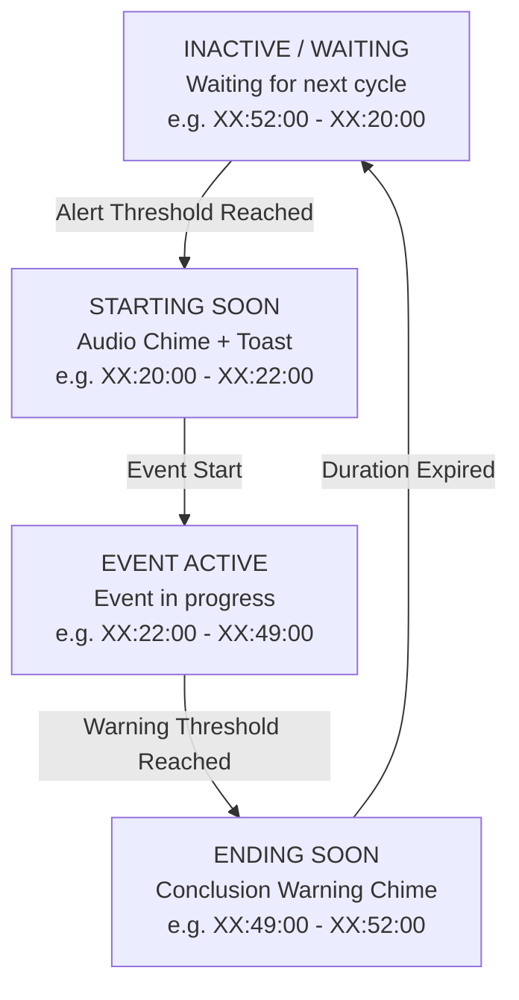

# Once Human: Event Timer

[](https://github.com/vtstv/StarfallTimer/actions)


[](LICENSE)


A lightweight Windows desktop HUD overlay for **Once Human** that tracks recurring in-game world events in real time. Features zero-drift game time synchronization, multi-timer tracking, full and compact mini HUD modes, Win32 click-through integration, procedural audio alerts, and trilingual localization.

---

## Table of Contents

- [Features](#features)
- [Supported Event Presets](#supported-event-presets)
- [HUD Preview](#hud-preview)
- [Event Phase Lifecycle](#event-phase-lifecycle)
- [Game Time Synchronization](#game-time-synchronization)
- [Default Hotkeys & Controls](#default-hotkeys--controls)
- [Architecture](#architecture)
- [Building from Source](#building-from-source)
- [Packaging & Releases](#packaging--releases)
- [Configuration Reference](#configuration-reference)
- [Authors & License](#authors--license)

---

## Features

- **Universal Event Scheduling Engine**:
  - Built-in presets for major Once Human world events and custom wheel schedules.
  - Configurable cycle length (e.g., 15m, 45m, 60m, 240m), start minute offset, active duration, and accent color.
  - Real-time recalculation upon settings modification.

- **Multi-Timer Support**:
  - Track multiple active events concurrently.
  - Toggle individual timers on or off in the HUD via Settings.
  - Displays as stacked cards in Full HUD mode or clean rows in Compact Mini mode.

- **Zero-Drift Game Time Synchronization**:
  - Compensates for clock drift between the local system clock and Once Human game servers.
  - Calibrated default `-31s` offset for Gravity Abyss (Starfall Inversion) to match server timing out of the box.
  - One-click synchronization: enter remaining in-game countdown (e.g. `12:45`) to calculate exact server offset.
  - Quick nudge buttons (`-5s`, `-1s`, `+1s`, `+5s`, `0s`) for real-time fine adjustment.

- **Dual Display Modes (Full & Mini HUD)**:
  - **Full HUD**: Circular countdown ring, linear progress bar, phase badge, and next start/end timestamps.
  - **Mini HUD**: Minimal floating pill showing only essential phase status and MM:SS countdown.
  - Quick-toggle button (`🗗` / `🗖`) on overlay header and in Settings.

- **HUD Customization & Non-Intrusive Overlay**:
  - Frameless, semi-transparent window with dark cyberpunk theme.
  - Real-time opacity slider (20% to 100%) and scalable UI sizing (0.7x to 2.0x).
  - Position lock toggle (`🔓` / `🔒`) prevents accidental dragging during gameplay.
  - Win32 Click-Through mode (`WS_EX_TRANSPARENT`): mouse clicks pass directly into the game without losing window focus.

- **Procedural Audio Alerts**:
  - In-memory PCM WAV synthesis for zero external audio dependencies.
  - Distinct harmonic chords for each phase:
    - *Starting Soon*: Two-tone ascending chime (660 Hz -> 880 Hz).
    - *Event Start*: Four-note major arpeggio celebration chime (C5 -> E5 -> G5 -> C6).
    - *Ending Soon*: Three-tone descending caution chime (A5 -> F5 -> D5).
  - Optional support for custom WAV sound files.

- **Seamless GitHub Self-Updater**:
  - In-app update check against GitHub Releases API with changelog display.
  - Download progress indicator and detached Windows in-place replacement with automatic restart.

- **System Tray & Toast Notifications**:
  - Taskbar notification tray icon with application icon rendering and context menu.
  - Windows desktop toast notifications when event windows approach.

- **Multilingual Support**:
  - English (`en-US`) - Default
  - German (`de-DE`)
  - Russian (`ru-RU`)

- **Lightweight Distribution**:
  - Framework-dependent single-file executable at ~0.7 MB footprint (< 1 MB).
  - Low CPU usage (< 0.1%) with zero heap allocations in the 1-second timer loop.

---

## Supported Event Presets

| Event Preset | Cycle | Start | Duration | Default Offset | Accent Color | Description |
| :--- | :--- | :--- | :--- | :--- | :--- | :--- |
| **Gravity Abyss (Starfall Inversion)** | 60 min | XX:22 | 30 min | -31s | `#00F0FF` | Hourly low-gravity tide with floating Stardust Crystals. |
| **Cargo Scramble (Sproutlet Truck)** | 60 min | XX:00 | 20 min | 0s | `#F59E0B` | Competitive convoy escort and Sproutlet gathering. |
| **Lunar Oracle (Blood Moon)** | 60 min | XX:45 | 15 min | 0s | `#EF4444` | Blood moon aberration anomaly event. |
| **Lunar Revelry (Lord of Moonlight)** | 60 min | XX:40 | 20 min | 0s | `#A855F7` | Moonlight festival world gathering event. |
| **Aberrant Progeny (Spore Tide)** | 60 min | XX:10 | 25 min | 0s | `#10B981` | Spore tide aberration defense wave. |
| **Dissonant Resonance** | 60 min | XX:15 | 30 min | 0s | `#EC4899` | Dynamic world frequency disruption zone. |
| **Crate Loot Reset (4-Hour)** | 240 min | XX:00 | 5 min | 0s | `#3B82F6` | Global crate and stronghold resource respawn window. |
| **Custom Wheel Event** | User | User | User | 0s | `#EAB308` | Fully customizable interval, start minute, and duration. |

---

## HUD Preview

### Full HUD Mode
```text
┌────────────────────────────────────────────────────────┐
│  ● GRAVITY ABYSS                   [ 🗗 ] [ 🔓 ] [ ⚙ ] [ ✕ ] │
├────────────────────────────────────────────────────────┤
│                                                        │
│     ╭─────╮     EVENT ACTIVE                           │
│   ╭─╯     ╰─╮                                          │
│   │  18:42  │   24:18                                  │
│   ╰─╮     ╭─╯   EVENT ENDS IN                          │
│     ╰─────╯                                            │
│                                                        │
│  [==========================------------------------]  │
│                                        Next End: 17:52 │
│  Offset: -31s (Game Sync)                              │
└────────────────────────────────────────────────────────┘
```

### Compact Mini HUD Mode
```text
┌──────────────────────────────────────────────┐
│  ● GRAVITY ABYSS   ACTIVE   24:18   [ 🗖 ] [ ✕ ] │
└──────────────────────────────────────────────┘
```

### Phase Visual Indicators

| Phase State | Accent Color | Visual Meaning |
| :--- | :--- | :--- |
| **Inactive / Waiting** | Neon Cyan (`#00F0FF`) | Event idle, waiting for the next scheduled window. |
| **Starting Soon** | Amber Warning (`#F59E0B`) | Event starts within alert threshold (default: 2 minutes). |
| **Active** | Active Gold / Cyan (`#EAB308`) | Event is in progress. |
| **Ending Soon** | Red Alert (`#EF4444`) | Event concludes within warning threshold (default: 3 minutes). |

---

## Event Phase Lifecycle



---

## Game Time Synchronization

Server clocks can differ from local system time by several seconds. To calibrate:

1. Open **Settings** (`⚙`) and select the **Events & Presets** tab.
2. Check the countdown timer displayed on your in-game map or HUD (e.g., `08:23`).
3. Enter `08:23` into the **Game Timer** field and click **Sync**.
4. The application computes the difference (`TimeOffsetSeconds`) and applies it immediately.
5. Use the quick nudge buttons (`-5s`, `-1s`, `+1s`, `+5s`, `0s`) to make finer adjustments during gameplay.

---

## Default Hotkeys & Controls

| Shortcut | Action | Description |
| :--- | :--- | :--- |
| <kbd>Ctrl</kbd> + <kbd>Alt</kbd> + <kbd>S</kbd> | Toggle Overlay | Toggles HUD overlay visibility on or off. |
| <kbd>Ctrl</kbd> + <kbd>Alt</kbd> + <kbd>L</kbd> | Toggle Click-Through | Switches between interactive dragging and transparent click-through mode. |
| <kbd>Left Click + Drag</kbd> | Move HUD | Drags the HUD when position lock is disabled (`🔓`). |
| <kbd>Right Click</kbd> (Tray Icon) | Tray Menu | Opens context menu to access Settings, toggle lock, or exit. |

---

## Architecture

The project is structured into 4 decoupled assemblies following clean architecture principles:

```text
StarfallTimer.sln
├── src/
│   ├── StarfallTimer.Core            # Pure domain models, scheduling engine, localization (.NET 8)
│   │   ├── Localization/             # Catalogs (English, German, Russian)
│   │   ├── Models/                   # EventDefinition, EventSnapshot, UserSettings, UpdateInfo
│   │   ├── Scheduling/               # EventScheduler, EventTimeCalculator, NotificationEvaluator
│   │   └── Services/                 # Interfaces (IEventScheduler, IAudioService, IUpdateService, etc.)
│   │
│   ├── StarfallTimer.Infrastructure  # OS integration & Windows services (.NET 8 Windows)
│   │   ├── Audio/                    # SynthesizerAudioService (in-memory WAV synthesis)
│   │   ├── Notifications/            # WindowsNotificationService (toast notifications)
│   │   ├── Storage/                  # FileSettingsService (atomic JSON persistence)
│   │   ├── Updates/                  # GitHubUpdateService (releases API, self-update script)
│   │   └── Win32/                    # NativeMethods, Win32HotkeyService, Win32TrayService
│   │
│   └── StarfallTimer.UI              # Presentation layer (WPF, MVVM, CommunityToolkit)
│       ├── Assets/                   # app.ico (multi-resolution application icon)
│       ├── Controls/                 # CircularTimerProgress ring control
│       ├── Converters/               # BoolToVisibilityConverter, StringNullOrEmptyToVisibilityConverter
│       ├── Styles/                   # Cyberpunk dark ControlTemplates (ComboBox, TabControl, etc.)
│       ├── ViewModels/               # OverlayViewModel, SettingsViewModel, TimerItemViewModel
│       └── Views/                    # OverlayWindow, SettingsWindow
│
└── tests/
    └── StarfallTimer.Tests           # Automated xUnit test suite
        ├── LocalizationTests.cs      # Translation completeness and key parity
        ├── MultiTimerTests.cs        # Multi-timer evaluation and snapshot handling
        ├── SchedulerTests.cs         # Boundary calculations and cycle rollovers
        ├── UniversalSchedulerTests.cs# Custom cycles, drift offsets, and game time sync
        └── UpdateServiceTests.cs     # Update detection and version parsing tests
```

---

## Building from Source

### Prerequisites

- Windows 10 (version 19041+) or Windows 11
- [.NET 8.0 SDK](https://dotnet.microsoft.com/download/dotnet/8.0) or higher
- [.NET Desktop Runtime 8.0](https://dotnet.microsoft.com/download/dotnet/8.0/runtime) (for running framework-dependent builds)

### Build Steps

```powershell
# 1. Clone repository
git clone https://github.com/vtstv/StarfallTimer.git
cd StarfallTimer

# 2. Restore dependencies
dotnet restore

# 3. Build solution (Release)
dotnet build --configuration Release --no-restore

# 4. Run automated test suite
dotnet test --configuration Release --no-build --verbosity normal

# 5. Launch application
dotnet run --project src/StarfallTimer.UI --configuration Release
```

---

## Packaging & Releases

An automated PowerShell script builds, tests, publishes, and packages releases into the `release/` directory:

```powershell
# Build lightweight framework-dependent package (~0.7 MB, requires .NET 8 runtime)
.\scripts\build-release.ps1 -Version "1.2.0"

# Build self-contained standalone executable (includes .NET runtime)
.\scripts\build-release.ps1 -Version "1.2.0" -Standalone:$true
```

Output is bundled into `release/OnceHumanTimer-v<version>/` and compressed to `release/OnceHumanTimer-v<version>.zip`.

See [CHANGELOG.md](CHANGELOG.md) for version release notes.

---

## Configuration Reference

Configuration is stored in `%APPDATA%\OnceHumanStarfallTimer\settings.json`:

```json
{
  "OverlayPositionX": 40.0,
  "OverlayPositionY": 40.0,
  "Opacity": 0.92,
  "Scale": 1.0,
  "IsClickThrough": false,
  "IsLocked": false,
  "AlwaysOnTop": true,
  "CompactMode": false,
  "Volume": 0.8,
  "Language": "en-US",
  "ActiveEventId": "gravity-abyss",
  "GlobalTimeOffsetSeconds": 0,
  "Events": [
    {
      "Id": "gravity-abyss",
      "Name": "Gravity Abyss (Starfall Inversion)",
      "CycleMinutes": 60,
      "StartMinute": 22,
      "DurationMinutes": 30,
      "TimeOffsetSeconds": -31,
      "ColorHex": "#00F0FF",
      "IsEnabled": true,
      "Description": "Once Human Starfall Inversion hourly event with low-gravity tide."
    },
    {
      "Id": "cargo-scramble",
      "Name": "Cargo Scramble (Sproutlet Truck)",
      "CycleMinutes": 60,
      "StartMinute": 0,
      "DurationMinutes": 20,
      "TimeOffsetSeconds": 0,
      "ColorHex": "#F59E0B",
      "IsEnabled": false,
      "Description": "Once Human Cargo Scramble event."
    }
  ],
  "AlertMinutesBefore": 2,
  "AlertMinutesBeforeEnd": 3,
  "PlayAlertSound": true,
  "ShowToastAlert": true,
  "PlayOnEventStart": true,
  "ToggleVisibilityHotkey": "Ctrl+Alt+S",
  "ToggleClickThroughHotkey": "Ctrl+Alt+L"
}
```

---

## Authors & License

- **Author & Maintainer**: **Murr** ([@vtstv](https://github.com/vtstv))
- **License**: Licensed under the [MIT License](LICENSE).
- **Disclaimer**: *Once Human* is a registered trademark of Starry Studio / NetEase Games. This utility is an unofficial companion tool developed under gaming accessibility guidelines.
