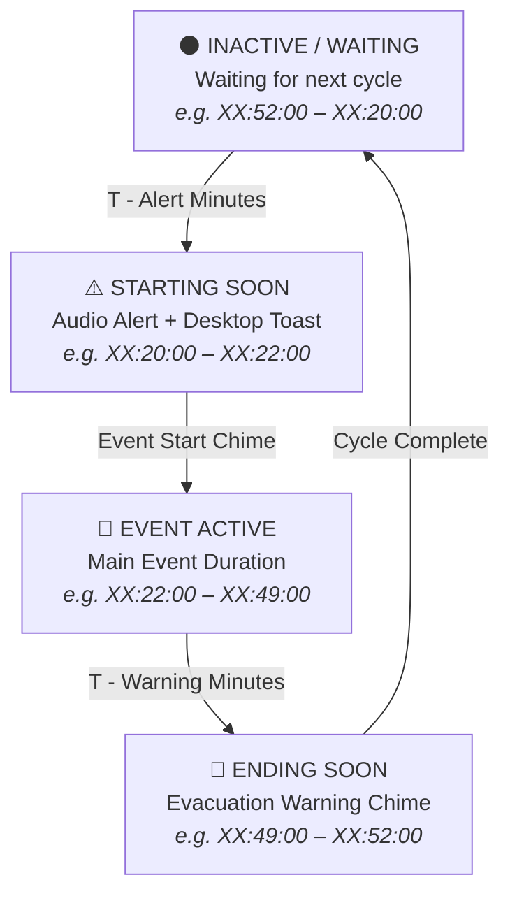

# Once Human: Event Timer 🌌⏱️

[](https://github.com/vtstv/StarfallTimer/actions)


[](LICENSE)


A sleek, ultra-lightweight (< 1 MB), cyberpunk desktop HUD overlay for **Once Human**, tracking recurring in-game world events in real-time. Supports **Gravity Abyss (Starfall Inversion)**, **Cargo Scramble**, and fully customizable multi-wheel event cycles with zero-drift game server synchronization, Win32 click-through technology, procedural audio alerts, and trilingual localization (English, German, Russian).

---

## 📖 Table of Contents

- [Overview & Supported Events](#-overview--supported-events)
- [Key Features](#-key-features)
- [HUD Preview](#-hud-preview)
- [Event Phase Lifecycle](#-event-phase-lifecycle)
- [Game Time Synchronization](#-game-time-synchronization)
- [Default Hotkeys & Controls](#-default-hotkeys--controls)
- [Architecture Overview](#-architecture-overview)
- [Prerequisites & Building from Source](#-prerequisites--building-from-source)
- [Packaging & Releases](#-packaging--releases)
- [Configuration Reference](#-configuration-reference)
- [Authors & Credits](#-authors--credits)
- [License](#-license)

---

## 🌠 Overview & Supported Events

In **Once Human**, timed world events dictate high-yield gathering windows, PvP opportunities, and dynamic world mechanics:

- **Gravity Abyss (Starfall Inversion)**:
  - **Default Cycle**: Hourly (60 minutes).
  - **Schedule**: Starts at `XX:22:00`, concludes at `XX:52:00` (30-minute duration).
  - **Mechanics**: Low-gravity tide allows players to float and scale cliffs; floating Stardust Crystals spawn for rare endgame crafting materials.
- **Cargo Scramble**:
  - **Schedule**: Recurring competitive convoy event (`XX:00:00` to `XX:20:00`).
- **Custom Wheel Events**:
  - Define arbitrary cycle lengths (e.g. 15, 30, 45, 90, 120 minutes), custom start offsets, custom durations, and unique neon accent colors.

**Once Human Event Timer** ensures you never miss a world event window, providing pinpoint countdowns, procedural audio alerts, and zero-latency game awareness.

---

## ✨ Key Features

- **Universal Multi-Wheel Event Engine**:
  - Preloaded with built-in presets: *Gravity Abyss*, *Cargo Scramble*, and *Custom Wheel*.
  - Full support for arbitrary cycle intervals, start minutes, active durations, and custom neon color styling.
  - Switch active events on-the-fly with immediate HUD recalculation.

- **Precision Game Time Synchronization (Zero Drift)**:
  - Eliminate clock disparity between your local PC clock and Once Human game servers.
  - Enter the remaining time displayed on your in-game map or HUD (e.g. `08:23`) and click **Sync** to match game servers down to the exact second.
  - Quick nudge buttons (`-5s`, `-1s`, `+1s`, `+5s`, `0s`) for instantaneous fine-tuning during gameplay.

- **Ultra-Lightweight Distribution (< 1 MB)**:
  - Optimized framework-dependent single-file packaging reduced the binary footprint from 70 MB down to **~0.7 MB** (< 1 MB)!
  - Rapid launch time, ultra-low CPU utilization (< 0.1%), and zero heap allocation in the 1-second tick loop.

- **Frameless Cyberpunk HUD Overlay**:
  - Deep obsidian transparent card (`#0B0F17`) with dynamic neon accent glow.
  - Active event title badge, circular countdown ring, and synchronized linear progression bar.
  - Resizable scale (0.7x to 2.0x) and background opacity (20% to 100%).
  - Position lock toggle (`🔓` / `🔒`) prevents accidental mouse drag during combat.
  - Dedicated About dialog (`ℹ`) with release details, GitHub links, and author credits.

- **Non-Intrusive Click-Through Mode**:
  - Native Windows API integration (`WS_EX_TRANSPARENT` & `WS_EX_LAYERED`).
  - When enabled, mouse clicks and cursor aiming pass directly through the HUD into *Once Human* without window focus stutter.

- **Procedural In-Memory Audio Synthesis**:
  - Built-in audio engine generating pure PCM WAV chimes dynamically in memory without external audio dependencies.
  - Distinct harmonic chords for each phase:
    - **Starting Soon**: 2-tone alert chime (660 Hz → 880 Hz).
    - **Event Start**: 4-note major arpeggio celebration chime (C5 → E5 → G5 → C6).
    - **Ending Soon**: Descending caution tones (A5 → F5 → D5).
  - Optional support for user-specified custom `.wav` sound files.

- **Desktop Notifications & System Tray**:
  - Windows taskbar notification tray icon with comprehensive context menu.
  - Configurable Windows desktop toast notifications when an event window approaches.

- **Multilingual Support**:
  - Instant on-the-fly language switching without application restart:
    - 🇺🇸 **English** (`en-US`, default)
    - 🇩🇪 **German** (`de-DE`, complete native translation)
    - 🇷🇺 **Russian** (`ru-RU`, complete native translation)

- **Configurable Global Hotkeys**:
  - Register system-wide key combinations via Win32 `RegisterHotKey` for instant overlay toggling and click-through switching even while full-screen in-game.

---

## 🖥️ HUD Preview

```text
┌────────────────────────────────────────────────────────┐
│  ● GRAVITY ABYSS                   [ ℹ ] [ 🔓 ] [ ⚙ ] [ ✕ ] │
├────────────────────────────────────────────────────────┤
│                                                        │
│     ╭─────╮     EVENT ACTIVE                           │
│   ╭─╯     ╰─╮                                          │
│   │  18:42  │   24:18                                  │
│   ╰─╮     ╭─╯   EVENT ENDS IN                          │
│     ╰─────╯                                            │
│                                                        │
│  [==========================------------------------]  │
│                                        Next End: 17:52 │
│  Offset: +31s (Game Sync)                              │
└────────────────────────────────────────────────────────┘
```

### Visual State Palette

| Phase State | Neon Accent | Hex Code | Visual Meaning |
| :--- | :--- | :--- | :--- |
| **Inactive / Waiting** | Neon Cyan | `#00F0FF` | Waiting for next scheduled event window. |
| **Starting Soon** | Amber Warning | `#F59E0B` | Event starts in ≤ 2 minutes (prepare gear and teleport). |
| **Active** | Event Theme / Gold | `#00E5FF` / `#EAB308` | Event is active; reap bonuses and gather loot! |
| **Ending Soon** | Red Alert | `#EF4444` | Event concludes in ≤ 3 minutes (evacuate safely). |

---

## 🔄 Event Phase Lifecycle



---

## ⏱️ Game Time Synchronization

PC clocks often diverge slightly from game servers (e.g. 15 to 45 seconds drift). **Once Human Event Timer** provides seamless sync:

1. Open **Settings** (`⚙`) → navigate to the **Events & Presets** tab.
2. Note the remaining countdown on your in-game map or event HUD (e.g. `08:23`).
3. Enter `08:23` into the **Game Timer** field and click **Sync**.
4. The timer calculates the exact delta (`TimeOffsetSeconds`) and synchronizes the HUD instantly.
5. Use quick nudge buttons (`-5s`, `-1s`, `+1s`, `+5s`, `0s`) anytime for fine-tuning.

---

## ⌨️ Default Hotkeys & Controls

| Shortcut | Action | Description |
| :--- | :--- | :--- |
| <kbd>Ctrl</kbd> + <kbd>Alt</kbd> + <kbd>S</kbd> | **Toggle Overlay** | Shows or hides the HUD overlay window instantly. |
| <kbd>Ctrl</kbd> + <kbd>Alt</kbd> + <kbd>L</kbd> | **Toggle Click-Through / Lock** | Toggles between interactive dragging and transparent click-through mode. |
| <kbd>Left Click + Drag</kbd> | **Move HUD** | Repositions the HUD when position lock is disabled (`🔓`). |
| <kbd>Right Click</kbd> (Tray Icon) | **Context Menu** | Access settings, toggle lock, show HUD, or exit application. |

---

## 🏗️ Architecture Overview

The solution adheres strictly to clean architectural separation across 4 distinct projects:

```
StarfallTimer.sln
├── src/
│   ├── StarfallTimer.Core             # Pure domain models, scheduling & localization (.NET 8)
│   │   ├── Localization/              # Catalogs (EnglishCatalog, GermanCatalog, RussianCatalog)
│   │   ├── Models/                    # EventDefinition, EventSnapshot, UserSettings
│   │   ├── Scheduling/                # EventTimeCalculator, StarfallEventScheduler
│   │   └── Services/                  # Interfaces (IEventScheduler, IAudioService, ILocalizationService)
│   │
│   ├── StarfallTimer.Infrastructure   # Win32 P/Invoke & Windows services (.NET 8 Windows)
│   │   ├── Audio/                     # SynthesizerAudioService (pure in-memory WAV synthesis)
│   │   ├── Notifications/             # WindowsNotificationService (balloon/toast notifications)
│   │   ├── Storage/                   # FileSettingsService (atomic JSON persistence)
│   │   └── Win32/                     # NativeMethods, Win32HotkeyService, Win32TrayService
│   │
│   └── StarfallTimer.UI               # Presentation layer (WPF, MVVM, CommunityToolkit)
│       ├── Assets/                    # app.ico (multi-resolution Windows application icon)
│       ├── Controls/                  # CircularTimerProgress vector ring control
│       ├── Styles/                    # Dark cyberpunk ControlTemplates (TabControl, Buttons, Sliders)
│       ├── ViewModels/                # OverlayViewModel, SettingsViewModel, SettingsViewModel.Events
│       └── Views/                     # AboutWindow, OverlayWindow, SettingsWindow
│
└── tests/
    └── StarfallTimer.Tests            # Unit test suite (xUnit)
        ├── LocalizationTests.cs       # Translation coverage, placeholders, & fallback verification
        ├── SchedulerTests.cs          # Hourly boundary conditions & rollover calculations
        └── UniversalSchedulerTests.cs # Arbitrary cycles, drift offsets, & Game Time Sync
```

---

## 🚀 Prerequisites & Building from Source

### Prerequisites

- **Operating System**: Windows 10 (Build 19041+) or Windows 11 (x64 / ARM64).
- **SDK**: [.NET 8.0 SDK](https://dotnet.microsoft.com/download/dotnet/8.0) or higher.
- **Runtime**: [.NET Desktop Runtime 8.0](https://dotnet.microsoft.com/download/dotnet/8.0/runtime) (for framework-dependent releases).

### Build Instructions

1. **Clone the repository**:
   ```powershell
   git clone https://github.com/vtstv/StarfallTimer.git
   cd StarfallTimer
   ```

2. **Restore dependencies**:
   ```powershell
   dotnet restore
   ```

3. **Build the solution (Release configuration)**:
   ```powershell
   dotnet build --configuration Release --no-restore
   ```

4. **Execute automated unit tests**:
   ```powershell
   dotnet test --configuration Release --no-build --verbosity normal
   ```

5. **Run the overlay**:
   ```powershell
   dotnet run --project src/StarfallTimer.UI --configuration Release
   ```

---

## 📦 Packaging & Releases

Build an ultra-lightweight (< 1 MB) release package automatically using PowerShell:

```powershell
# Build standard lightweight release (~0.7 MB, framework-dependent)
.\scripts\build-release.ps1 -Version "1.1.0"

# Or produce self-contained standalone executable
.\scripts\build-release.ps1 -Version "1.1.0" -Standalone:$true
```

Output is bundled into `release/OnceHumanTimer-v<version>/` and zipped to `release/OnceHumanTimer-v<version>.zip`.

---

## ⚙️ Configuration Reference

Settings are stored in human-readable JSON format at `%APPDATA%\OnceHumanStarfallTimer\settings.json`:

```json
{
  "OverlayPositionX": 40.0,
  "OverlayPositionY": 40.0,
  "Opacity": 0.92,
  "Scale": 1.0,
  "IsClickThrough": false,
  "IsLocked": false,
  "AlwaysOnTop": true,
  "CompactMode": false,
  "Volume": 0.8,
  "Language": "en-US",
  "ActiveEventId": "gravity-abyss",
  "GlobalTimeOffsetSeconds": 0,
  "Events": [
    {
      "Id": "gravity-abyss",
      "Name": "Gravity Abyss (Starfall Inversion)",
      "CycleMinutes": 60,
      "StartMinute": 22,
      "DurationMinutes": 30,
      "TimeOffsetSeconds": 0,
      "ColorHex": "#00E5FF",
      "Description": "Once Human Starfall Inversion hourly event with low-gravity tide."
    },
    {
      "Id": "cargo-scramble",
      "Name": "Cargo Scramble",
      "CycleMinutes": 60,
      "StartMinute": 0,
      "DurationMinutes": 20,
      "TimeOffsetSeconds": 0,
      "ColorHex": "#F59E0B",
      "Description": "Once Human Cargo Scramble event."
    }
  ],
  "AlertMinutesBefore": 2,
  "AlertMinutesBeforeEnd": 3,
  "PlayAlertSound": true,
  "ShowToastAlert": true,
  "PlayOnEventStart": true,
  "ToggleVisibilityHotkey": "Ctrl+Alt+S",
  "ToggleClickThroughHotkey": "Ctrl+Alt+L"
}
```

---

## 👨‍💻 Authors & Credits

- **Author & Maintainer**: **Murr** ([@vtstv](https://github.com/vtstv))
- **Game Rights**: *Once Human* is a registered trademark and copyright of Starry Studio / NetEase Games. This utility is an unofficial open-source companion tool created under fair-use gaming accessibility guidelines.

---

## 📄 License

This project is licensed under the **MIT License** — see the [LICENSE](LICENSE) file for complete details.
